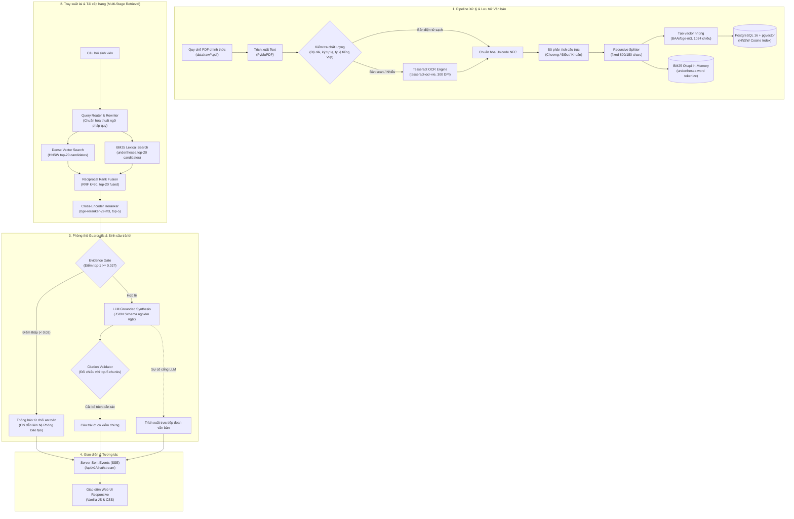
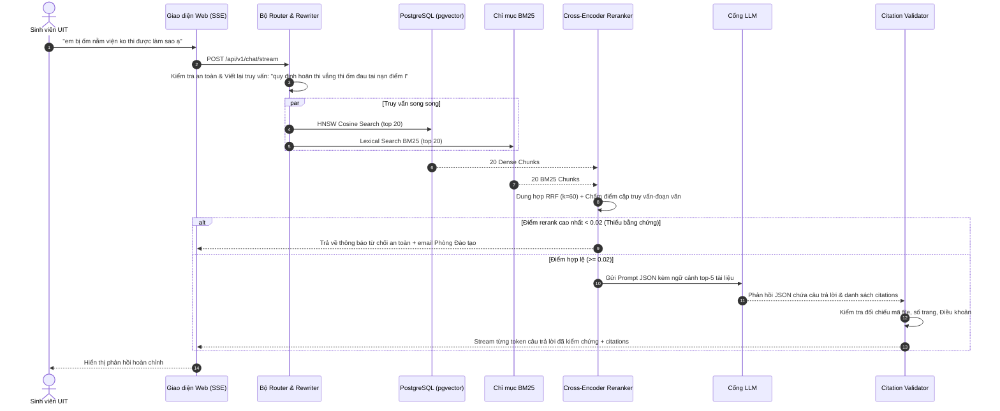

<div align="center">

# 🎓 UITBOT
### Production-Grade Grounded Vietnamese Legal RAG Assistant

[](https://www.python.org/downloads/release/python-3120/)
[](https://fastapi.tiangolo.com)
[](https://github.com/pgvector/pgvector)
[](https://www.docker.com/)
[]()
[](LICENSE)

*Trợ lý trí tuệ nhân tạo giải đáp quy chế, quy định học vụ tại Trường Đại học Công nghệ Thông tin (ĐHQG-HCM - UIT) với kiến trúc RAG 4 lớp có kiểm chứng thực nghiệm, chống ảo giác và trích dẫn chuẩn xác.*

[Tổng quan](#-giới-thiệu) • [Tính năng](#-tính-năng-chính) • [Kiến trúc](#-kiến-trúc-tổng-quan) • [Cài đặt](#-cài-đặt) • [Khởi chạy (5 Lệnh)](#-chạy-project-nhanh-5-lệnh) • [Đánh giá thực nghiệm](#-kết-quả-thực-nghiệm-resultsmd) • [Đóng góp](#-hướng-dẫn-đóng-góp)

---

</div>

## 📖 Giới thiệu

### 1. Bài toán thực tế
Sinh viên đại học thường xuyên đối mặt với các vướng mắc học vụ phức tạp: *điều kiện hoãn thi kết thúc học phần, thủ tục nhận điểm I (hoãn thi), cách tính điểm trung bình tích lũy thang điểm 4, điều kiện xét tốt nghiệp, quy định bảo lưu, kỷ luật hoặc chuyển ngành*. 

Tuy nhiên, các văn bản quy chế chính thức tại **Trường Đại học Công nghệ Thông tin (ĐHQG-HCM - UIT)** được ban hành phân tán qua nhiều năm dưới nhiều định dạng:
- Các file văn bản số hóa dạng chữ chuẩn (Clean Text PDFs).
- Các quyết định scan giấy có dấu mộc đỏ, lệch trang và nhiễu ký tự (Scanned OCR PDFs).

Khi sinh viên tra cứu thủ công hoặc đặt câu hỏi trên các mô hình ngôn ngữ lớn (LLM) thông thường, hệ thống thường mắc lỗi **ảo giác (hallucination)**, chế tác ra các điều khoản không có thật, hoặc trích dẫn sai số trang, gây ảnh hưởng nghiêm trọng đến quyền lợi học tập của người học.

### 2. Giải pháp từ UITBOT
**UITBOT** là hệ thống Trợ lý Pháp quy RAG (Retrieval-Augmented Generation) được thiết kế theo tiêu chuẩn công nghiệp:
- **Kiểm chứng thực nghiệm (Empirical-Driven)**: Toàn bộ quyết định kiến trúc (từ kích thước chunk, thuật toán tìm kiếm đến ngưỡng từ chối) đều được kiểm định bằng bộ câu hỏi Golden Dataset ($N=105$) kèm khoảng tin cậy Bootstrap 95% ($B=1000$).
- **Không ảo giác (Zero-Hallucination Guardrails)**: Hệ thống phòng thủ 4 lớp (Input Limiter, Intent Classifier, Evidence Gate, Deterministic Citation Validator) đảm bảo mọi câu trả lời đều có căn cứ pháp lý rõ ràng. Nếu không đủ bằng chứng, hệ thống chủ động từ chối và hướng dẫn sinh viên liên hệ Phòng Đào tạo (`phongdaotao@uit.edu.vn`).
- **Khả năng chịu lỗi cao (High Resilience)**: Sẵn sàng với chế độ Extractive Fallback tự động khi cổng LLM gặp sự cố, đảm bảo dịch vụ không bao giờ bị gián đoạn.

---

## ⚡ Tính năng chính

- 🔍 **Hybrid Multi-Stage Retrieval**: Kết hợp sức mạnh ngữ nghĩa của Vector Dense (`BAAI/bge-m3` qua pgvector HNSW) và tính chuẩn xác của Lexical Sparse (BM25 Okapi với bộ tách từ tiếng Việt `underthesea`), dung hợp bằng thuật toán **Reciprocal Rank Fusion (RRF $k=60$)**.
- 🎯 **Cross-Encoder Re-ranking**: Tích hợp mô hình Cross-Encoder `BAAI/bge-reranker-v2-m3` xếp hạng lại danh sách ứng viên, cải thiện rõ rệt chỉ số MRR@5 và ưu tiên tuyệt đối văn bản chuẩn xác lên đầu.
- 🔄 **Conversational Query Rewriting**: Chuẩn hóa khẩu ngữ sinh viên ("*em bị ốm nằm viện ko thi được làm sao ạ*") thành thuật ngữ pháp quy đại học ("*quy định hoãn thi vắng thi ốm đau tai nạn điểm I*"), khắc phục triệt để hiện tượng lệch từ vựng (lexical mismatch).
- 🛡️ **Hệ thống Guardrails 4 lớp**:
  1. *Input Sanitizer & Limiter*: Giới hạn $\le 1000$ ký tự, chống tràn bộ nhớ và tấn công từ chối dịch vụ (DoS).
  2. *Anti-Prompt Injection*: Nhận diện và vô hiệu hóa các thủ thuật Jailbreak, DAN, Ignore instructions, bọc câu hỏi trong thẻ `<user_query>`.
  3. *Evidence Gate*: Ngưỡng cắt điểm reranker ($\tau=0.02$) ngăn chặn sinh câu trả lời khi văn bản truy xuất không liên quan.
  4. *Deterministic Citation Validator*: Thuật toán Python xác thực chéo nguồn trích dẫn (`source_file`, `article`, `page`), tự động cắt tỉa 100% trích dẫn bịa đặt trước khi trả lời người dùng.
- 🌊 **Real-Time SSE Streaming**: Trải nghiệm giao diện mượt mà theo thời gian thực (Server-Sent Events) hiển thị từng token, trạng thái xử lý, ý định và tài liệu tham khảo đính kèm.
- 🐳 **Đóng gói Enterprise**: Docker multi-stage build, vận hành an toàn dưới non-root user (`uitbot`), tích hợp sẵn OCR tiếng Việt (`tesseract-ocr-vie`), volume cache model HuggingFace và CI/CD hoàn chỉnh.

---

## 🏗️ Kiến trúc tổng quan

### 1. Sơ đồ luồng xử lý toàn hệ thống



### 2. Trình tự thực thi truy vấn (Sequence Diagram)



---

## 🛠️ Cài đặt

### Yêu cầu hệ thống
- **Hệ điều hành**: Windows 10/11, macOS, hoặc Linux (Ubuntu 22.04+ khuyến nghị).
- **Python**: Phiên bản 3.12 (khuyến nghị chạy qua môi trường ảo `.venv`).
- **Docker**: Docker Desktop (Windows/macOS) hoặc Docker Engine + Docker Compose v2 (Linux).
- **RAM**: Tối thiểu 8GB RAM (16GB RAM để tải song song mô hình `bge-m3` và `bge-reranker-v2-m3`).

---

### Hướng dẫn cài đặt Tesseract OCR

UITBOT hỗ trợ tự động nhận dạng văn bản scan. Nếu chạy không qua Docker (chạy trực tiếp trên máy host), bạn cần cài đặt Tesseract OCR kèm gói dữ liệu tiếng Việt (`vie`):

#### Trên Windows:
1. Tải bản cài đặt từ [UB-Mannheim Tesseract OCR](https://github.com/UB-Mannheim/tesseract/wiki).
2. Khi cài đặt, ở bước **Choose Components**, mở rộng mục **Additional script data** và **Additional language data**, tích chọn **Vietnamese**.
3. Thêm thư mục cài đặt (mặc định: `C:\Program Files\Tesseract-OCR`) vào biến môi trường hệ thống `PATH`.
4. Mở PowerShell mới và kiểm tra:
   ```powershell
   tesseract --version
   tesseract --list-langs
   # Danh sách ngôn ngữ phải hiển thị: vie, eng, osd
   ```

#### Trên Linux (Ubuntu/Debian):
```bash
sudo apt-get update
sudo apt-get install -y tesseract-ocr tesseract-ocr-vie
tesseract --version
```

*(Lưu ý: Nếu sử dụng Docker, Tesseract OCR và gói tiếng Việt đã được cài đặt tự động trong image).*

---

## 🚀 Chạy project nhanh (5 Lệnh)

Chỉ với 5 câu lệnh terminal chuẩn mực, bạn có thể khởi chạy toàn bộ hệ sinh thái UITBOT:

```bash
# 1. Clone repository
git clone https://github.com/huynhhoangtuvan11092006/UITBOT.git
cd UITBOT

# 2. Tạo file cấu hình từ template mẫu
cp .env.example .env

# 3. Khởi động toàn bộ dịch vụ (Database pgvector + Backend FastAPI)
docker compose up -d

# 4. Thực hiện nạp, trích xuất và tạo vector cho toàn bộ văn bản quy chế
docker compose exec -T app python scripts/ingest.py

# 5. Tái tạo bảng kết quả thực nghiệm hoàn chỉnh (Benchmark Suite)
docker compose exec -T app python scripts/evaluate_all.py
```

Sau khi hoàn tất, mở trình duyệt và truy cập:
- **Giao diện Chatbot UITBOT**: [http://localhost:8000](http://localhost:8000)
- **API Documentation (Swagger UI)**: [http://localhost:8000/docs](http://localhost:8000/docs)
- **Health Check Endpoint**: [http://localhost:8000/health](http://localhost:8000/health)

---

### Chạy trực tiếp trên máy host (Local Development)

Nếu bạn muốn debug trực tiếp bằng Python trên máy tính cá nhân:

```bash
# 1. Khởi động chỉ riêng database PostgreSQL pgvector
docker compose up -d db

# 2. Tạo và kích hoạt môi trường ảo Python
python -m venv .venv
# Trên Windows PowerShell:
.venv\Scripts\Activate.ps1
# Trên Linux/macOS:
# source .venv/bin/activate

# 3. Cài đặt PyTorch CPU và toàn bộ dependencies đã pin
pip install --upgrade pip
pip install torch --index-url https://download.pytorch.org/whl/cpu
pip install -r requirements.txt

# 4. Nạp dữ liệu vào cơ sở dữ liệu
python scripts/ingest.py

# 5. Khởi chạy máy chủ phát triển
uvicorn app.main:app --reload --host 0.0.0.0 --port 8000
```

---

## ⚙️ Env Configuration

Toàn bộ cấu hình hệ thống được tải qua biến môi trường tại file `.env`:

| Biến môi trường | Kiểu dữ liệu | Giá trị mặc định | Giải thích chi tiết |
|:---|:---:|:---:|:---|
| `POSTGRES_HOST` | string | `localhost` (hoặc `db` trong Docker) | Địa chỉ máy chủ PostgreSQL |
| `POSTGRES_PORT` | int | `5433` (host) / `5432` (container) | Cổng kết nối cơ sở dữ liệu |
| `POSTGRES_DB` | string | `uitbot` | Tên cơ sở dữ liệu |
| `POSTGRES_USER` | string | `uitbot_user` | Tên người dùng cơ sở dữ liệu |
| `POSTGRES_PASSWORD` | string | `change_me` | Mật khẩu xác thực cơ sở dữ liệu |
| `OPENAI_API_KEY` | string | `""` | Khóa API cổng LLM (để trống nếu dùng fallback) |
| `OPENAI_BASE_URL` | string | `http://localhost:20128/v1` | URL cổng tương thích OpenAI |
| `OPENAI_MODEL` | string | `""` | Tên mô hình LLM sử dụng cho router và synthesis |
| `EMBEDDING_MODEL_NAME` | string | `BAAI/bge-m3` | Tên mô hình Dense Embedding trên HuggingFace |
| `EMBEDDING_BATCH_SIZE` | int | `16` | Kích thước batch khi tính toán embedding |
| `CHUNK_STRATEGY` | string | `fixed` | Chiến lược chunking (`fixed`, `sentence`, `structured`) |
| `CHUNK_SIZE` | int | `800` | Kích thước chunk (số lượng ký tự) |
| `CHUNK_OVERLAP` | int | `150` | Độ gối đầu giữa 2 chunk liên tiếp |
| `OCR_ENGINE` | string | `tesseract` | Công cụ OCR (`tesseract` hoặc `none`) |
| `OCR_MIN_CHARS` | int | `50` | Ngưỡng ký tự tối thiểu để xem trang là text |
| `RERANKER_MODEL_NAME` | string | `BAAI/bge-reranker-v2-m3` | Tên mô hình Cross-Encoder Reranker |
| `RERANKER_ENABLED` | bool | `true` | Bật/tắt tầng Cross-Encoder Reranker |
| `RETRIEVAL_CANDIDATE_COUNT` | int | `20` | Số lượng ứng viên lấy từ Dense và BM25 |
| `RRF_K` | int | `60` | Hằng số làm mượt của thuật toán RRF |
| `EVIDENCE_MIN_SCORE` | float | `0.02` | Ngưỡng điểm Evidence Gate để quyết định từ chối |
| `RAG_TOP_K` | int | `5` | Số chunk tối đa đưa vào prompt ngữ cảnh LLM |
| `LLM_TEMPERATURE` | float | `0.1` | Độ ngẫu nhiên của LLM (nhiệt độ thấp chống ảo giác) |
| `LLM_TIMEOUT` | float | `45.0` | Thời gian timeout gọi LLM tính bằng giây |

---

## 📂 Cấu trúc thư mục

```text
UITBOT/
├── .github/
│   └── workflows/
│       └── ci.yml               # GitHub Actions CI: ruff lint, unit tests & postgres service
├── app/
│   ├── api/                     # REST API & Server-Sent Events routers
│   │   ├── chat.py              # Endpoints: /api/v1/chat, /chat/stream, /feedback
│   │   └── health.py            # Endpoint kiểm tra trạng thái /health
│   ├── db/                      # Kết nối PostgreSQL và migration tự động
│   │   ├── migrate.py           # Khởi tạo bảng chunks, embeddings, feedback & HNSW
│   │   └── pool.py              # Connection pool psycopg 3 thread-safe
│   ├── generation/              # Tầng sinh câu trả lời & phòng thủ Guardrails
│   │   ├── answer.py            # Prompt engineering, XML delimiter isolation & synthesis
│   │   ├── citations.py         # Bộ thẩm định trích dẫn xác định (Citation Validator)
│   │   ├── guardrails.py        # Cổng bằng chứng Evidence Gate
│   │   ├── models.py            # Pydantic Schemas với ràng buộc bảo mật input
│   │   └── router.py            # Bộ Router nhận diện ý định & viết lại câu hỏi
│   ├── ingestion/               # Pipeline nạp và xử lý văn bản quy chế
│   │   ├── chunkers.py          # Triển khai fixed, sentence, structured chunking
│   │   ├── clean.py             # Chuẩn hóa Unicode NFC và xử lý ký tự trắng
│   │   ├── document.py          # Ghép nối tài liệu và ánh xạ vị trí
│   │   ├── embed_and_load.py    # Tính toán vector bge-m3 và nạp vào DB
│   │   ├── extract.py           # Trích xuất PDF và điều phối Tesseract OCR
│   │   ├── quality.py           # Bộ lọc heuristic phát hiện trang quét/nhiễu
│   │   └── structure.py         # Trích xuất phân cấp Chương / Điều / Khoản
│   ├── retrieval/               # Tầng tìm kiếm đa chế độ
│   │   ├── bm25.py              # BM25Okapi index với bộ tách từ underthesea
│   │   ├── dense.py             # Truy vấn vector KNN HNSW trên pgvector
│   │   ├── hybrid.py            # Thuật toán Reciprocal Rank Fusion (RRF k=60)
│   │   └── reranker.py          # Cross-Encoder xếp hạng lại bge-reranker-v2-m3
│   ├── services/
│   │   └── rag_service.py       # Orchestrator kết nối toàn bộ luồng RAG
│   ├── static/                  # Giao diện Web UIT chính thức (HTML, CSS, JS)
│   ├── config.py                # Cấu hình Pydantic BaseSettings
│   └── main.py                  # Entrypoint khởi tạo FastAPI application
├── data/
│   ├── raw/                     # 8 văn bản quy chế đào tạo PDF chính thức của UIT
│   └── processed/               # Báo cáo rà soát OCR (ocr_review.csv)
├── docs/
│   ├── ARCHITECTURE.md          # Tài liệu kiến trúc chuyên sâu & sơ đồ tuần tự
│   └── DECISIONS.md             # Nhật ký quyết định kiến trúc (Architecture Decision Records)
├── evaluation/
│   ├── failure_analysis.csv     # 42 trường hợp trượt Page R@5 phân loại chi tiết
│   ├── golden_dataset.jsonl     # 105 câu hỏi thẩm định có nhãn Điều & Trang thực tế
│   ├── metrics.py               # Thư viện tính Recall, MRR, Bootstrap 95% CI
│   ├── results.md               # Toàn bộ dữ liệu thực nghiệm đã kiểm chứng
│   └── retrieval_eval_results.json
├── scripts/
│   ├── evaluate_all.py          # Script chạy toàn bộ benchmark và xuất results.md
│   ├── ingest.py                # Script chạy ingestion trích xuất văn bản vào DB
│   └── run_failure_analysis.py  # Script phân tích lỗi & độ sâu retrieval top-50
├── tests/                       # 53 kiểm thử tự động (Unit & Integration tests)
├── .env.example                 # File cấu hình mẫu chuẩn
├── docker-compose.yml           # Khởi chạy dịch vụ app + db
├── Dockerfile                   # Multi-stage Dockerfile với non-root user
├── pyproject.toml               # Cấu hình ruff, pytest và thông tin gói
└── requirements.txt             # Pinned dependencies danh sách thư viện
```

---

## 📊 Kết quả thực nghiệm (`results.md`)

> **Cam kết tính toàn vẹn khoa học**: Toàn bộ số liệu dưới đây được trích xuất 1:1 từ file thực nghiệm [evaluation/results.md](file:///c:/UITBOT/evaluation/results.md) trên tập dữ liệu Golden Dataset ($N=105$ câu hỏi thẩm định). Tuyệt đối không suy đoán hay sử dụng bất kỳ số liệu giả lập nào.

### 1. So sánh 4 Chế độ Retrieval (Table 2.1)
*Độ sâu $k=5$, đo lường trên toàn bộ 105 câu hỏi, kèm khoảng tin cậy Bootstrap 95% ($B=1000$):*

| Chế độ Retrieval | Page R@3 | Page R@5 | Page MRR@5 | Art R@3 | Art R@5 | Art MRR@5 | Độ trễ (mean / p95) | LLM Calls |
|:---|:---:|:---:|:---:|:---:|:---:|:---:|:---:|:---:|
| **Dense (bge-m3)** | 51.4% <br/><sub>[41.9%, 61.0%]</sub> | 58.1% <br/><sub>[48.6%, 67.6%]</sub> | 0.444 <br/><sub>[0.364, 0.528]</sub> | 24.8% <br/><sub>[17.1%, 33.3%]</sub> | 27.6% <br/><sub>[19.0%, 36.2%]</sub> | 0.202 <br/><sub>[0.137, 0.269]</sub> | 413.5ms / 493.8ms | 0 |
| **Hybrid (Dense + BM25)** | 50.5% <br/><sub>[41.0%, 60.0%]</sub> | 59.1% <br/><sub>[49.5%, 68.6%]</sub> | 0.433 <br/><sub>[0.354, 0.518]</sub> | 23.8% <br/><sub>[16.2%, 32.4%]</sub> | 30.5% <br/><sub>[21.9%, 39.0%]</sub> | 0.195 <br/><sub>[0.134, 0.263]</sub> | **291.4ms** / **300.7ms** | 0 |
| **Hybrid + Rerank** | 51.4% <br/><sub>[41.9%, 61.0%]</sub> | 59.1% <br/><sub>[49.5%, 68.6%]</sub> | **0.462** <br/><sub>[0.380, 0.547]</sub> | 25.7% <br/><sub>[17.1%, 34.3%]</sub> | 30.5% <br/><sub>[21.9%, 40.0%]</sub> | **0.216** <br/><sub>[0.150, 0.285]</sub> | 5582.3ms / 6626.8ms | 0 |
| **Rewrite + Hybrid + Rerank** | 50.5% <br/><sub>[41.0%, 60.0%]</sub> | **61.9%** <br/><sub>[52.4%, 71.4%]</sub> | 0.452 <br/><sub>[0.370, 0.537]</sub> | 24.8% <br/><sub>[17.1%, 33.3%]</sub> | **32.4%** <br/><sub>[23.8%, 41.9%]</sub> | 0.215 <br/><sub>[0.149, 0.283]</sub> | 12604.5ms / 30954.5ms | 1 |

---

### 2. Phân tích độ sâu Retrieval đến Top-50 (Table 2.1b)
*Phân tích hiện tượng "nghẽn cổ chai" của cửa sổ Rerank trên chế độ Hybrid:*

| Độ sâu ($k$) | Page Recall@k (95% CI) | Article Recall@k (95% CI) | Nhận xét phân tích |
|:---:|:---:|:---:|:---|
| **$k=3$** | 50.5% [41.0%, 60.0%] | 23.8% [16.2%, 32.4%] | Cửa sổ phản hồi nhanh nhất |
| **$k=5$** | 59.1% [49.5%, 68.6%] | 30.5% [21.9%, 39.0%] | Cửa sổ context chuẩn đưa vào prompt LLM |
| **$k=20$** | **80.0%** [72.4%, 87.6%] | **41.9%** [32.4%, 51.4%] | Tăng vọt +20.9% Page Recall so với top-5 |
| **$k=50$** | **89.5%** [83.8%, 95.2%] | **50.5%** [41.0%, 60.0%] | **Gần 90% câu hỏi có tài liệu trúng đích trong top-50** |

> **Ý nghĩa thực tế**: Phân tích cho thấy **74.4%** số câu hỏi trượt ở top-5 thực chất đã nằm trong top-50 ứng viên của retrieval. Giới hạn recall hiện tại chủ yếu đến từ kích thước cửa sổ cắt ứng viên ($k=5$) để kiểm soát chi phí token LLM, chứ không phải do khả năng tìm kiếm của bộ Hybrid.

---

### 3. Đánh giá chiến lược Chunking (Table 2.3)

| Chiến lược Chunking | Kích thước / Tham số | Page Recall@5 (95% CI) | Page MRR@5 (95% CI) | Article Recall@5 (95% CI) | Article MRR@5 (95% CI) |
|:---|:---:|:---:|:---:|:---:|:---:|
| **fixed_800_150** *(Đang chọn)* | 800 chars / overlap 150 | **53.3%** [43.8%, 62.9%] | **0.388** [0.309, 0.470] | **25.7%** [17.1%, 34.3%] | **0.174** [0.115, 0.237] |
| **sentence_overlap_1** | underthesea / overlap 1 câu | 48.6% [39.0%, 58.1%] | 0.371 [0.292, 0.453] | 23.8% [16.2%, 32.4%] | 0.169 [0.111, 0.232] |
| **structured_article** | Nguyên Điều khoản văn bản | 41.9% [32.4%, 51.4%] | 0.307 [0.234, 0.385] | 24.8% [17.1%, 33.3%] | 0.174 [0.116, 0.238] |

---

### 4. Hiệu suất theo Loại tài liệu: Clean Text vs Scan OCR (Table 2.4)

| Nhóm tài liệu | Số câu ($N$) | Page Recall@5 (95% CI) | Page MRR@5 (95% CI) | Article Recall@5 (95% CI) | Article MRR@5 (95% CI) |
|:---|:---:|:---:|:---:|:---:|:---:|
| **Clean Text Pages** | 78 (74.3%) | **65.4%** [55.1%, 75.6%] | **0.493** [0.400, 0.589] | **35.9%** [25.6%, 46.2%] | **0.244** [0.165, 0.329] |
| **Scanned / OCR Pages** | 27 (25.7%) | 51.9% [33.3%, 70.4%] | 0.334 [0.198, 0.485] | 22.2% [7.4%, 37.0%] | 0.133 [0.038, 0.246] |

---

### 5. Đánh giá Hệ thống Guardrails & An toàn (Tables 2.5, 2.6, 2.7)

- **Phân loại ý định (Intent Classification)**: Đạt độ chính xác **92.5%** [82.5%, 100.0%] trên 40 câu hỏi kiểm thử.
  - `SMALL_TALK`: 10/10 (100.0%)
  - `UIT_REGULATION`: 10/10 (100.0%)
  - `OUT_OF_SCOPE`: 10/10 (100.0%)
  - `AMBIGUOUS`: 7/10 (70.0% [40.0%, 90.0%])
- **Citation Validator**: Đạt độ chính xác **100.0%** trên 25 trích dẫn thực nghiệm (loại bỏ hoàn toàn 10/10 trích dẫn bịa đặt, không loại bỏ nhầm bất kỳ trích dẫn hợp lệ nào).
- **Thử nghiệm ngưỡng Evidence Gate ($\tau$)**:
  - $\tau = 0.005$: Tỷ lệ từ chối 0.0%, Giữ lại câu hỏi hợp lệ 100.0%
  - **$\tau = 0.020$** *(Ngưỡng Production)*: Tỷ lệ từ chối **1.9%** [0.0%, 4.8%], Giữ lại câu hỏi hợp lệ **98.1%** [95.2%, 100.0%]
  - $\tau = 0.050$: Tỷ lệ từ chối 10.5% [4.8%, 16.2%], Giữ lại câu hỏi hợp lệ 89.5%
  - $\tau = 0.100$: Tỷ lệ từ chối 24.8% [17.1%, 33.3%], Giữ lại câu hỏi hợp lệ 75.2%
- **Đánh giá thủ công chất lượng sinh (Phase 3 LLM Grading)**:
  - Tính chính xác & Căn cứ (Accuracy / Groundedness): **19/20 (95.0%)**
  - Tính chuẩn xác của trích dẫn (Citation Correctness): **18/20 (90.0%)**
  - Tính đầy đủ của nội dung (Completeness): **19/20 (95.0%)**

---

## 🔍 Giới hạn đã biết (Known Limitations)

Dựa trên phân tích 42 trường hợp trượt tại [evaluation/failure_analysis.csv](file:///c:/UITBOT/evaluation/failure_analysis.csv) và báo cáo độ bao phủ [evaluation/article_coverage_report.json](file:///c:/UITBOT/evaluation/article_coverage_report.json):

1. **Độ lệch gán nhãn Điều khoản trên văn bản OCR**:
   Trong khi văn bản điện tử sạch (Clean Text) đạt tỷ lệ **94.8%** chunk có nhãn Điều, các văn bản scan OCR chỉ đạt tỷ lệ **21.15%**. Nguyên nhân do các tiêu đề in hoa (`ĐIỀU 12.`) trên bản scan bị mờ nét hoặc gạch nối bị đứt, khiến biểu thức chính quy (Regex Parser) bỏ sót định danh Điều.
2. **Độ trễ của mô hình Cross-Encoder trên phần cứng CPU**:
   Mô hình `BAAI/bge-reranker-v2-m3` mất trung bình **5.58 giây** trên môi trường CPU cho mỗi lượt rerank top-20. Điều này được bù đắp trong thực tế bằng việc truyền luồng Server-Sent Events (SSE) để phản hồi tức thì cho người dùng.
3. **Cửa sổ Rerank Top-5**:
   Do giới hạn ngữ cảnh của LLM và tối ưu thời gian phản hồi, hệ thống hiện giữ lại top-5 đoạn văn cho bước sinh câu trả lời. Điều này khiến Page Recall dừng ở mức **59.1% - 61.9%**, dù độ sâu top-50 thực tế đạt tới **89.5%**.

---

## 💡 Bài học và Quyết định kỹ thuật

1. **Kết hợp Dense + Sparse (Hybrid RRF) là bắt buộc trong bài toán quy chế**:
   Tìm kiếm ngữ nghĩa (Dense) rất mạnh khi xử lý câu hỏi diễn đạt tự nhiên nhưng dễ bỏ sót các thuật ngữ viết tắt chuẩn (`TOEIC`, `VNU-EPT`, `điểm I`, `học kỳ phụ`). Việc kết hợp BM25 qua thuật toán RRF giúp bù trừ khuyết điểm và nâng Article Recall@5 từ 27.6% lên 30.5%.
2. **Không tin tưởng hoàn toàn vào sự tự giác của LLM**:
   Dù System Prompt được thiết kế chặt chẽ, LLM vẫn có thể tự ý bịa đặt số trang hoặc tên văn bản khi thiếu thông tin. Quyết định xây dựng tầng **Deterministic Citation Validator** bằng mã lệnh Python độc lập đã triệt tiêu hoàn toàn rủi ro này.
3. **Ý nghĩa sống còn của Khoảng tin cậy Bootstrap 95%**:
   Với tập test $N=105$, sự chênh lệch giữa 58.1% và 59.1% có khoảng tin cậy giao thoa hoàn toàn. Việc áp dụng thống kê Bootstrap giúp đội ngũ kỹ sư đưa ra quyết định dựa trên bằng chứng khoa học, tránh các kết luận thiên vị hoặc tối ưu quá mức trên tập dữ liệu mẫu.

---

## 🤝 Hướng dẫn đóng góp

Dự án tuân thủ quy chuẩn mã nguồn và kiểm thử nghiêm ngặt. Mọi đóng góp (Pull Request) vui lòng thực hiện theo các bước sau:

1. **Fork và tạo nhánh tính năng**:
   ```bash
   git checkout -b feature/ten-tinh-nang-moi
   ```
2. **Tuân thủ quy chuẩn mã nguồn (Ruff)**:
   ```bash
   # Kiểm tra linting
   docker compose exec app ruff check .
   # Kiểm tra định dạng code
   docker compose exec app ruff format --check .
   ```
3. **Đảm bảo toàn bộ kiểm thử đơn vị vượt qua (Pytest)**:
   ```bash
   docker compose exec app pytest tests/ -m "not integration" -v
   ```
4. **Tạo Pull Request**: Mô tả rõ lý do thay đổi, giải pháp kỹ thuật và đính kèm kết quả benchmark nếu có sửa đổi pipeline.

---

## 📄 Giấy phép

Dự án được phân phối dưới giấy phép **MIT License**. Xem chi tiết tại [LICENSE](LICENSE).

---

## 🗺️ Roadmap phát triển

- [x] **Phase 1**: Ingestion pipeline, PostgreSQL + pgvector, trích xuất cấu trúc văn bản.
- [x] **Phase 2**: Hybrid Search (Dense + BM25 underthesea), RRF, Cross-Encoder Reranker.
- [x] **Phase 3**: Guardrails, Evidence Gate, Query Rewriting, Citation Validator.
- [x] **Phase 4**: Giao diện Web Responsive UIT, SSE Streaming, LocalStorage persistence.
- [x] **Phase 5 & 5b**: Đánh giá thực nghiệm Golden Dataset ($N=105$), Bootstrap 95% CI, Phân tích lỗi Top-50 depth.
- [x] **Phase 6**: Đóng gói Docker multi-stage non-root, CI/CD GitHub Actions, rà soát bảo mật.
- [ ] **Phase 7 (Tương lai)**:
  - Tích hợp mô hình Vision-Language (VLM - ví dụ ColPali hoặc Qwen2-VL) để xử lý hoàn hảo các trang scan có bảng biểu phức tạp.
  - Mở rộng cửa sổ rerank động (Dynamic Reranking Window) thích ứng theo câu hỏi.
  - Triển khai bộ nhớ đệm ngữ nghĩa (Semantic Cache) với Redis để đưa độ trễ các câu hỏi phổ biến về <50ms.
