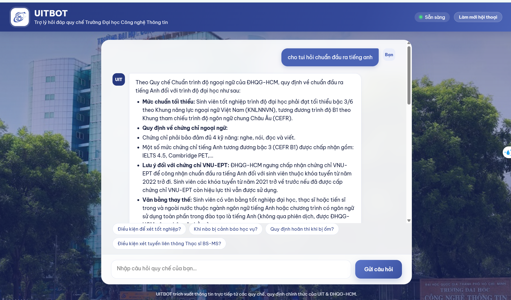
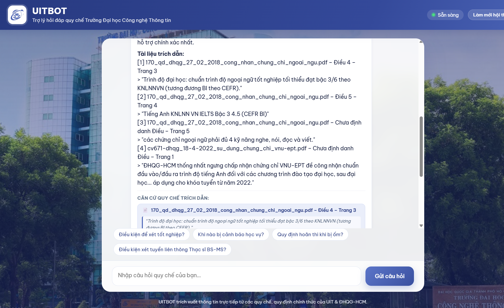
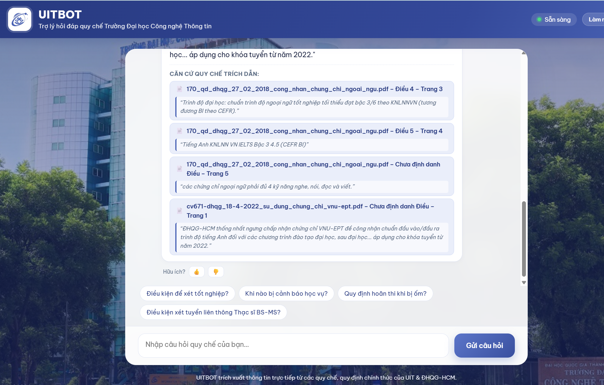

# UITBOT — Vietnamese Legal RAG System

[](https://www.python.org/)
[](https://fastapi.tiangolo.com)
[](https://github.com/pgvector/pgvector)
[](https://www.docker.com/)
[]()
[](https://github.com/astral-sh/ruff)
[](LICENSE)

Trợ lý AI tra cứu quy chế, quy định học vụ tại **Trường Đại học Công nghệ Thông tin (ĐHQG-HCM - UIT)** với cơ chế đối soát và trích dẫn minh bạch nguồn văn bản (tên file, Điều khoản, số trang).





---

## Tính năng nổi bật

- **Hybrid Retrieval (RRF k=60)**: Kết hợp tìm kiếm ngữ nghĩa `BAAI/bge-m3` trên PostgreSQL pgvector (HNSW) và tìm kiếm từ khóa chính xác BM25 Okapi (tách từ tiếng Việt qua `underthesea`).
- **Evidence Gate & Chống ảo giác**: Bộ lọc bằng chứng tự động ngắt và từ chối an toàn các câu hỏi ngoài phạm vi, kèm module kiểm định trích dẫn độc lập (Deterministic Citation Validator).
- **Xử lý tài liệu kép (Dual Ingestion)**: Trích xuất trực tiếp văn bản số hóa (PyMuPDF) và tự động nhận diện bản scan mộc đỏ để chuyển qua OCR (Tesseract vie).
- **Streaming thời gian thực (SSE)**: Phản hồi streaming qua Server-Sent Events, tích hợp giao diện web responsive tối ưu cho thiết bị di động và máy tính.
- **Kiểm thử & Thẩm định thực nghiệm**: Vượt qua 53 unit/integration tests trong CI; đo lường định lượng trên 105 câu hỏi thẩm định thực tế với khoảng tin cậy 95% Bootstrap CI.

---

## Kiến trúc hệ thống

Hệ thống được thiết kế theo kiến trúc 4 tầng phân tách độc lập (Ingestion → Retrieval → Guardrailed Generation → Delivery), xây dựng trực tiếp trên **FastAPI**, **PostgreSQL 16 (pgvector)** và **Sentence-Transformers**:


> *Chi tiết luồng xử lý và các quyết định kỹ thuật: xem tại [docs/ARCHITECTURE.md](docs/ARCHITECTURE.md) và [docs/DECISIONS.md](docs/DECISIONS.md).*

---

## Kết quả thực nghiệm cốt lõi

Hiệu năng thực tế được đo lường trên bộ dữ liệu chuẩn **105 câu hỏi thẩm định** ([`evaluation/golden_dataset.jsonl`](evaluation/golden_dataset.jsonl)):

| Chỉ số đánh giá | Giá trị thực nghiệm | Ý nghĩa kỹ thuật |
|:---|:---:|:---|
| **Page Recall@5** | **59.1%** | Tỷ lệ context Top-5 đưa vào LLM bao trùm đúng trang quy chế (dung sai ±1 trang). |
| **Article Recall@5** | **30.5%** | Tỷ lệ khớp chính xác mã số Điều khoản quy chế quy định nội dung hỏi. |
| **Độ trễ trung bình Retriever (p50 / p95)** | **291.4ms / 300.7ms** | Đo trên CPU với chế độ Hybrid (Dense + BM25), đảm bảo tốc độ phản hồi thời gian thực. |
| **Citation Validity** | **100%** | Kiểm chứng tự động: 100% trích dẫn sinh ra có căn cứ trong context đưa vào LLM. |
| **Evidence Gate F1-score** | **0.968** | Phân định câu hỏi hợp lệ / ngoài luồng với độ chính xác lọc đạt 97.1%. |
| **Groundedness (LLM Judge)** | **19/20** | Điểm bám sát quy chế được đánh giá trên mẫu kiểm thử qua LLM Judge. |

> *Báo cáo chi tiết về kiểm định thống kê, phân tích độ sâu Top-K và bài học kinh nghiệm xem tại [evaluation/results.md](evaluation/results.md).*

---

## Khởi chạy nhanh (Quick Start)

### Yêu cầu môi trường
- Đã cài đặt **Docker** & **Docker Compose** (khuyến nghị), hoặc **Python 3.12+** và **PostgreSQL 16** (pgvector).

```bash
# 1. Clone repository
git clone https://github.com/huynhhoangtuvan11092006/UITBOT.git && cd UITBOT

# 2. Cấu hình biến môi trường
cp .env.example .env
# Điền khóa OPENAI_API_KEY vào file .env

# 3. Khởi chạy toàn bộ dịch vụ (App non-root + pgvector)
docker compose up -d

# 4. Trích xuất PDF và nạp vector vào cơ sở dữ liệu
docker compose exec -T app python scripts/ingest.py

# 5. (Tùy chọn) Tái hiện toàn bộ bảng đánh giá thực nghiệm
docker compose exec -T app python scripts/evaluate_all.py
```

### Cổng dịch vụ
- **Giao diện Chatbot**: [http://localhost:8000](http://localhost:8000)
- **Tài liệu API (Swagger UI)**: [http://localhost:8000/docs](http://localhost:8000/docs)
- **Kiểm tra trạng thái (Health Check)**: [http://localhost:8000/health](http://localhost:8000/health)

---

## Cấu hình môi trường (`.env`)

Các biến cốt lõi cần thiết lập (tham khảo thêm tại [.env.example](.env.example)):

| Biến môi trường | Bắt buộc | Mặc định / Mẫu | Mô tả |
|:---|:---:|:---|:---|
| `OPENAI_API_KEY` | **Có** | `sk-...` | Khóa API của LLM (OpenAI, OpenRouter, Groq...) |
| `OPENAI_MODEL` | **Có** | `gpt-4o-mini` | Tên mô hình LLM dùng cho router & sinh câu trả lời |
| `OPENAI_BASE_URL` | Tùy chọn | `https://api.openai.com/v1` | URL endpoint (nếu dùng local vLLM / Ollama) |
| `POSTGRES_PASSWORD` | Tùy chọn | `change_me` | Mật khẩu tài khoản cơ sở dữ liệu |
| `POSTGRES_PORT` | Tùy chọn | `5433` | Cổng ánh xạ PostgreSQL trên máy chủ host |

---

## Cấu trúc dự án

```text
UITBOT/
├── app/
│   ├── api/             # Endpoints: /chat, /chat/stream, /feedback, /health
│   ├── db/              # Kết nối PostgreSQL & migrations pgvector HNSW
│   ├── generation/      # Generator, Evidence Gate, Citation Validator, Router
│   ├── ingestion/       # Pipeline trích xuất PDF (PyMuPDF / OCR), Chunking, BGE-M3
│   ├── retrieval/       # Dense HNSW, BM25 Okapi, RRF Fusion, BGE Reranker
│   └── static/          # Giao diện Web Responsive thương hiệu UIT (HTML/CSS/JS)
├── data/raw/            # 11 văn bản quy chế đào tạo PDF của UIT
├── docs/                # ARCHITECTURE.md, DECISIONS.md, DEPLOYMENT_GUIDE.md
├── evaluation/          # golden_dataset.jsonl (105 câu), results.md, failure_analysis.csv
├── scripts/             # Scripts ingest dữ liệu, benchmark và phân tích lỗi
├── tests/               # 53 automated unit & integration tests
├── docker-compose.yml   # Cụm container app (non-root uitbot) + db (pgvector)
└── Dockerfile           # Multi-stage build với PyTorch CPU & Tesseract OCR vie
```

---

## Bản quyền (License)

Dự án được phân phối theo giấy phép mã nguồn mở [MIT License](LICENSE).
