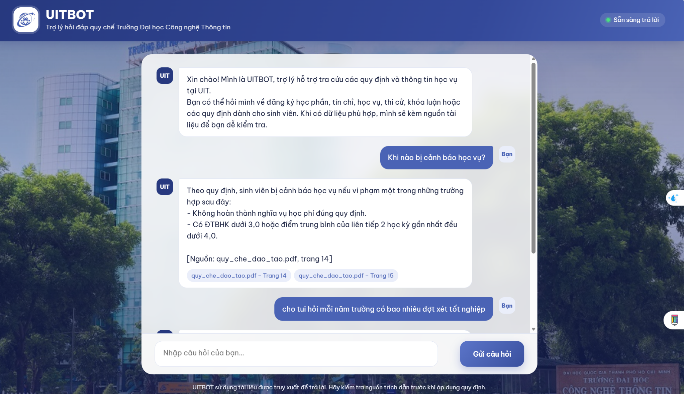
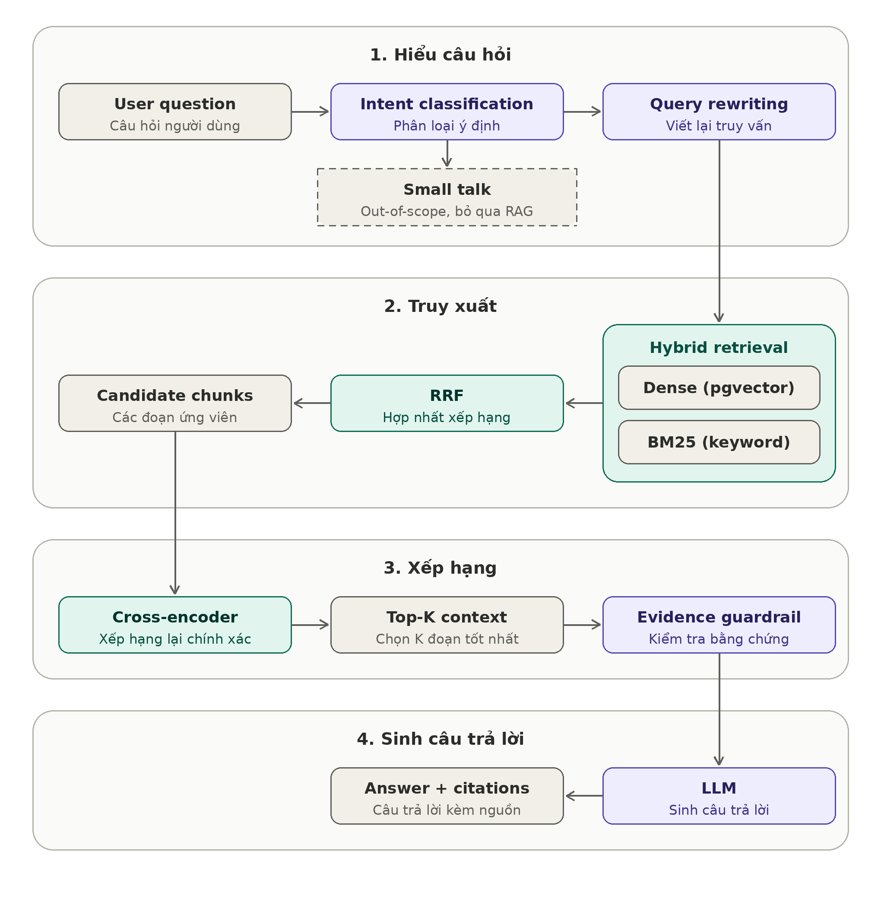

# UITBOT — Vietnamese University Regulation RAG Assistant

UITBOT answers questions about official academic regulations of the **University of Information Technology, VNU-HCM (UIT)**. It is a Retrieval-Augmented Generation (RAG) system that grounds every answer in retrieved passages from official documents and cites the source file and page.



## Features

- Hybrid retrieval: dense search (PostgreSQL + pgvector) + BM25, fused with Reciprocal Rank Fusion (RRF)
- Cross-encoder reranking (`BAAI/bge-reranker-v2-m3`)
- Query rewriting for informal Vietnamese queries and abbreviations
- Intent classification: regulation question, small talk, out-of-scope, ambiguous
- Evidence guardrail: no answer is generated without sufficient evidence
- Source citations (file + page)
- Langfuse tracing, FastAPI backend, web chat UI, Docker Compose deployment

## Architecture



## Tech Stack

| Component | Technology |
|---|---|
| Backend | Python 3.12, FastAPI |
| Vector DB | PostgreSQL + pgvector |
| Embedding | `paraphrase-multilingual-MiniLM-L12-v2` |
| Retrieval | BM25 + RRF |
| Reranker | `BAAI/bge-reranker-v2-m3` |
| LLM | OpenAI-compatible API |
| Observability | Langfuse |
| Deployment | Docker Compose |

## Retrieval Evaluation

Benchmark: 50 manually curated questions, 3 official UIT documents, page-level ground truth.

| Method | Recall@3 | Recall@5 | MRR@5 |
|---|---:|---:|---:|
| Dense | 36.00% | 42.00% | 0.3140 |
| Hybrid (Dense + BM25 + RRF) | 48.00% | 60.00% | 0.4247 |
| **Hybrid + Reranker** | **96.00%** | **96.00%** | **0.8600** |

The final pipeline retrieves the expected page in the top 5 for 48 of 50 questions.
These metrics measure retrieval only, not end-to-end answer accuracy.

Reproduce:

```bash
python evaluation/evaluate_retrieval.py
python evaluation/evaluate_hybrid.py
python evaluation/evaluate_reranking.py
```

## Knowledge Base

Three official UIT documents: credit-based undergraduate regulations, examination regulations, and graduation thesis regulations.

Ingestion: `PDF → text extraction → chunking → embeddings → PostgreSQL + pgvector`.
Each chunk stores `source_file`, `page`, `chunk_id`, `text`, `embedding`.

## Quick Start

```bash
git clone https://github.com/huynhhoangtuvan11092006/UITBOT.git
cd UITBOT
```

Create a `.env` file (never commit it):

```env
OPENAI_API_KEY=your_api_key
OPENAI_BASE_URL=your_openai_compatible_endpoint
OPENAI_MODEL=your_model_name

POSTGRES_HOST=localhost
POSTGRES_PORT=5433
POSTGRES_DB=uitbot
POSTGRES_USER=uitbot_user
POSTGRES_PASSWORD=your_password

LANGFUSE_SECRET_KEY=your_langfuse_secret_key
LANGFUSE_PUBLIC_KEY=your_langfuse_public_key
LANGFUSE_BASE_URL=https://cloud.langfuse.com
```

Ingest data (put PDFs in `data/raw/` first):

```bash
python scripts/extract_documents.py
python scripts/chunk_documents.py
python scripts/create_tables.py
python scripts/load_chunks_to_postgres.py
```

Run with Docker:

```bash
docker compose up -d --build
```

App: http://localhost:8000 · API docs: http://localhost:8000/docs

> Avoid `docker compose down -v` unless you want to delete the database volume.

## Project Structure

```text
UITBOT/
├── app/            # API (chat.py), RAG service, static web UI
├── data/           # raw PDFs and processed chunks
├── evaluation/     # golden dataset and evaluation scripts
├── scripts/        # extraction, chunking, DB loading
├── main.py
├── Dockerfile
├── docker-compose.yml
└── requirements.txt
```

## Example Questions

```text
Khi nào sinh viên bị cảnh báo học vụ?
Sinh viên đến trễ bao nhiêu phút thì không được dự thi?
Thời gian thực hiện khóa luận tốt nghiệp là bao lâu?
```


## Author

**Huỳnh Hoàng Tứ Văn** — University of Information Technology, VNU-HCM
GitHub: https://github.com/huynhhoangtuvan11092006

## Disclaimer

UITBOT is an educational project. Answers assist with information retrieval and do not replace official UIT announcements. Verify important decisions against the cited source documents.
