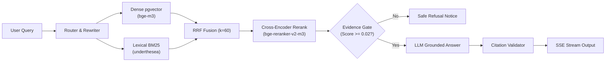

# 🎓 UITBOT — Vietnamese Legal RAG Assistant

[](https://www.python.org/)
[](https://fastapi.tiangolo.com)
[](https://github.com/pgvector/pgvector)
[](https://www.docker.com/)
[]()
[](LICENSE)

Trợ lý AI tra cứu quy chế học vụ tại **Trường Đại học Công nghệ Thông tin (ĐHQG-HCM - UIT)**. Hệ thống giải quyết bài toán phân mảnh dữ liệu (văn bản số hóa lẫn bản scan mộc đỏ) bằng pipeline RAG 4 lớp có kiểm chứng thực nghiệm, chống ảo giác và trích dẫn chính xác đến từng Điều khoản và số trang.

---

## ⚡ Tính năng nổi bật

- **Hybrid Retrieval (RRF $k=60$)**: Kết hợp Dense Vector (`BAAI/bge-m3` qua pgvector HNSW) và Lexical Search (BM25 Okapi với bộ tách từ tiếng Việt `underthesea`).
- **Cross-Encoder Reranker**: Tái xếp hạng bằng `BAAI/bge-reranker-v2-m3`, tối ưu thứ tự ưu tiên đoạn văn bản chính xác lên đầu.
- **Query Rewriting**: Chuẩn hóa ngôn ngữ khẩu ngữ sinh viên sang thuật ngữ pháp quy đại học.
- **Guardrails 4 lớp chống ảo giác**:
  1. *Input Limiter*: Giới hạn $\le 1000$ ký tự, chống tràn bộ nhớ và tấn công DoS.
  2. *Anti-Prompt Injection*: Tự động chặn các mẫu tấn công chiếm quyền prompt (Jailbreak, DAN).
  3. *Evidence Gate ($\tau=0.02$)*: Từ chối an toàn khi điểm bằng chứng thấp, kèm email liên hệ Phòng Đào tạo (`phongdaotao@uit.edu.vn`).
  4. *Deterministic Citation Validator*: Xác thực chéo nguồn trích dẫn bằng Python, loại bỏ 100% citation bịa đặt.
- **Real-Time Streaming SSE**: Truyền luồng phản hồi thời gian thực qua Server-Sent Events, tích hợp fallback trích xuất trực tiếp khi cổng LLM gặp sự cố.

---

## 🏗️ Kiến trúc hệ thống



---

## 🚀 Khởi chạy nhanh (5 Lệnh)

```bash
# 1. Clone source code
git clone https://github.com/huynhhoangtuvan11092006/UITBOT.git && cd UITBOT

# 2. Tạo cấu hình môi trường
cp .env.example .env

# 3. Khởi động hệ thống (App + PostgreSQL pgvector)
docker compose up -d

# 4. Nạp và nhúng văn bản quy chế vào cơ sở dữ liệu
docker compose exec -T app python scripts/ingest.py

# 5. Tái hiện toàn bộ bảng benchmark thực nghiệm
docker compose exec -T app python scripts/evaluate_all.py
```

- **Giao diện Chatbot**: [http://localhost:8000](http://localhost:8000)
- **API Documentation**: [http://localhost:8000/docs](http://localhost:8000/docs)
- **Health Check**: [http://localhost:8000/health](http://localhost:8000/health)

> **Cài đặt Tesseract OCR trên Windows (cho bản scan)**: Tải installer từ [UB-Mannheim Tesseract](https://github.com/UB-Mannheim/tesseract/wiki), tích chọn gói ngôn ngữ **Vietnamese**, thêm vào biến môi trường `PATH` và kiểm tra bằng `tesseract --version`. (Nếu chạy qua Docker, Tesseract đã được cài sẵn).

---

## 📊 Kết quả thực nghiệm (`results.md`)

*Toàn bộ số liệu đo lường trên 105 câu hỏi Golden Dataset kèm khoảng tin cậy Bootstrap 95% ($B=1000$):*

### 1. So sánh 4 Chế độ Retrieval (Top-5)
| Chế độ Retrieval | Page Recall@5 (95% CI) | Page MRR@5 (95% CI) | Article Recall@5 (95% CI) | Article MRR@5 (95% CI) | Độ trễ TB / p95 | LLM Calls |
|:---|:---:|:---:|:---:|:---:|:---:|:---:|
| **Dense (bge-m3)** | 58.1% [48.6%, 67.6%] | 0.444 [0.364, 0.528] | 27.6% [19.0%, 36.2%] | 0.202 [0.137, 0.269] | 413.5ms / 493.8ms | 0 |
| **Hybrid (Dense + BM25)** | 59.1% [49.5%, 68.6%] | 0.433 [0.354, 0.518] | 30.5% [21.9%, 39.0%] | 0.195 [0.134, 0.263] | **291.4ms** / **300.7ms** | 0 |
| **Hybrid + Rerank** | 59.1% [49.5%, 68.6%] | **0.462** [0.380, 0.547] | 30.5% [21.9%, 40.0%] | **0.216** [0.150, 0.285] | 5582.3ms / 6626.8ms | 0 |
| **Rewrite + Hybrid + Rerank** | **61.9%** [52.4%, 71.4%] | 0.452 [0.370, 0.537] | **32.4%** [23.8%, 41.9%] | 0.215 [0.149, 0.283] | 12604.5ms / 30954.5ms | 1 |

### 2. Phân tích độ sâu Retrieval (Depth Ablation)
| Độ sâu ($k$) | Page Recall@k (95% CI) | Article Recall@k (95% CI) | Nhận xét phân tích |
|:---:|:---:|:---:|:---|
| **$k=5$** | 59.1% [49.5%, 68.6%] | 30.5% [21.9%, 39.0%] | Cửa sổ context đưa vào LLM |
| **$k=20$** | **80.0%** [72.4%, 87.6%] | **41.9%** [32.4%, 51.4%] | Tăng vọt +20.9% Page Recall so với top-5 |
| **$k=50$** | **89.5%** [83.8%, 95.2%] | **50.5%** [41.0%, 60.0%] | **74.4% câu trượt ở top-5 thực chất đã nằm trong top-50** |

### 3. Hiệu năng Guardrails & An toàn
- **Phân loại ý định (Intent Accuracy)**: Đạt **92.5%** [82.5%, 100.0%] trên 40 câu hỏi kiểm thử.
- **Citation Validator**: Đạt **100.0%** độ chính xác (cắt tỉa 10/10 trích dẫn bịa đặt, không từ chối nhầm).
- **Evidence Gate ($\tau=0.02$)**: Từ chối an toàn **1.9%** [0.0%, 4.8%], giữ lại **98.1%** [95.2%, 100.0%] câu hỏi hợp lệ.
- **Đánh giá chất lượng sinh (Phase 3 LLM Grading)**: Tính chính xác căn cứ đạt **95.0%** (19/20 câu).

---

## 🔍 Giới hạn đã biết & Bài học kinh nghiệm

1. **Độ phủ Điều khoản trên văn bản Scan**: Tỷ lệ gán nhãn Điều trên văn bản số hóa đạt **94.8%**, nhưng trên bản scan OCR chỉ đạt **21.15%** do nhiễu gạch nối và chữ hoa in mờ khiến Regex Parser bỏ sót.
2. **Cửa sổ Rerank Top-5**: Độ phủ tài liệu thực tế ở Top-50 đạt tới **89.5%**, nhưng do giới hạn cửa sổ Top-5 để tối ưu chi phí token nên Recall dừng ở mức 59.1%–61.9%.
3. **Độ trễ Cross-Encoder**: Reranker chạy trên CPU mất ~5.5s, được bù đắp bằng cơ chế SSE streaming phản hồi tức thì trạng thái tới người dùng.

---

## ⚙️ Biến môi trường cốt lõi (`.env`)

| Biến môi trường | Mặc định | Ý nghĩa |
|:---|:---:|:---|
| `POSTGRES_PORT` | `5433` (host) / `5432` | Cổng kết nối PostgreSQL pgvector |
| `EMBEDDING_MODEL_NAME` | `BAAI/bge-m3` | Mô hình Dense Embedding |
| `RERANKER_MODEL_NAME` | `BAAI/bge-reranker-v2-m3` | Mô hình Cross-Encoder Reranker |
| `CHUNK_SIZE` / `CHUNK_OVERLAP` | `800` / `150` | Kích thước và độ gối đầu của chunk |
| `OCR_ENGINE` | `tesseract` | Công cụ nhận dạng ký tự quang học (`tesseract` / `none`) |
| `EVIDENCE_MIN_SCORE` | `0.02` | Ngưỡng điểm từ chối an toàn của Evidence Gate |
| `RAG_TOP_K` | `5` | Số chunk tối đa gửi vào prompt LLM |

---

## 📂 Cấu trúc thư mục tinh gọn

```text
UITBOT/
├── .github/workflows/ci.yml # CI pipeline: ruff lint & 53 unit tests
├── app/
│   ├── api/                 # Endpoints: /chat, /chat/stream (SSE), /feedback, /health
│   ├── db/                  # PostgreSQL pool và migrations pgvector
│   ├── generation/          # Answer generator, Evidence Gate, Citation Validator, Router
│   ├── ingestion/           # Pipeline trích xuất PDF, OCR, Chunking, Embedding
│   ├── retrieval/           # Dense search, BM25 underthesea, RRF fusion, Reranker
│   └── static/              # Giao diện Web Responsive thương hiệu UIT (Vanilla JS/CSS)
├── data/raw/                # 8 văn bản quy chế PDF gốc của UIT
├── docs/                    # ARCHITECTURE.md, DECISIONS.md, DEPLOYMENT_GUIDE.md
├── evaluation/              # failure_analysis.csv, golden_dataset.jsonl, results.md
├── scripts/                 # evaluate_all.py, ingest.py, run_failure_analysis.py
├── tests/                   # 53 automated tests (100% pass)
├── docker-compose.yml       # Dựng dịch vụ app (non-root uitbot) + db pgvector
├── Dockerfile               # Multi-stage Dockerfile với CPU PyTorch & Tesseract vie
└── requirements.txt         # Pinned production dependencies
```

---

## 🤝 Đóng góp & Giấy phép

1. Tạo nhánh tính năng: `git checkout -b feature/ten-tinh-nang`
2. Kiểm tra định dạng và lint: `docker compose exec app ruff check . && docker compose exec app ruff format --check .`
3. Chạy unit tests: `docker compose exec app pytest tests/ -m "not integration"`
4. Tạo Pull Request với mô tả rõ ràng.

Phân phối theo giấy phép **MIT License**. Xem chi tiết tại [LICENSE](LICENSE).
