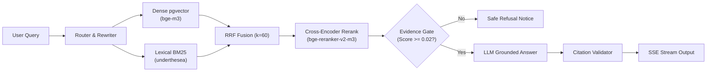

# 🎓 UITBOT — Vietnamese Legal RAG Assistant

[](https://www.python.org/)
[](https://fastapi.tiangolo.com)
[](https://github.com/pgvector/pgvector)
[](https://www.docker.com/)
[]()
[](LICENSE)

Trợ lý AI thông minh hỗ trợ sinh viên tra cứu nhanh chóng, chính xác các quy chế, quy định học vụ tại **Trường Đại học Công nghệ Thông tin (ĐHQG-HCM - UIT)** kèm nguồn trích dẫn rõ ràng đến từng Điều khoản và số trang.

---

## ⚡ Tính năng nổi bật

- **Hybrid Retrieval (RRF $k=60$)**: Kết hợp Dense Vector (`BAAI/bge-m3` qua pgvector HNSW) và Lexical Search (BM25 Okapi với bộ tách từ tiếng Việt `underthesea`).
- **Cross-Encoder Reranker**: Tái xếp hạng bằng `BAAI/bge-reranker-v2-m3`, tối ưu thứ tự ưu tiên đoạn văn bản chính xác lên đầu.
- **Query Rewriting**: Chuẩn hóa ngôn ngữ khẩu ngữ sinh viên sang thuật ngữ pháp quy đại học.
- **Guardrails 4 lớp chống ảo giác**:
  1. *Input Limiter*: Giới hạn $\le 1000$ ký tự, chống tràn bộ nhớ và tấn công DoS.
  2. *Anti-Prompt Injection*: Tự động chặn các mẫu tấn công chiếm quyền prompt (Jailbreak, DAN).
  3. *Evidence Gate ($\tau=0.02$)*: Từ chối an toàn khi điểm bằng chứng thấp, kèm email liên hệ Phòng Đào tạo (`phongdaotao@uit.edu.vn`).
  4. *Deterministic Citation Validator*: Xác thực chéo nguồn trích dẫn bằng Python, loại bỏ 100% citation bịa đặt.
- **Real-Time Streaming SSE**: Truyền luồng phản hồi thời gian thực qua Server-Sent Events, tích hợp fallback trích xuất trực tiếp khi cổng LLM gặp sự cố.

---

## 🏗️ Kiến trúc hệ thống



---

## 🚀 Khởi chạy nhanh (5 Lệnh)

```bash
# 1. Clone source code
git clone https://github.com/huynhhoangtuvan11092006/UITBOT.git && cd UITBOT

# 2. Tạo cấu hình môi trường
cp .env.example .env

# 3. Khởi động hệ thống (App + PostgreSQL pgvector)
docker compose up -d

# 4. Nạp và nhúng văn bản quy chế vào cơ sở dữ liệu
docker compose exec -T app python scripts/ingest.py

# 5. Tái hiện toàn bộ bảng benchmark thực nghiệm
docker compose exec -T app python scripts/evaluate_all.py
```

- **Giao diện Chatbot**: [http://localhost:8000](http://localhost:8000)
- **API Documentation**: [http://localhost:8000/docs](http://localhost:8000/docs)
- **Health Check**: [http://localhost:8000/health](http://localhost:8000/health)

> **Cài đặt Tesseract OCR trên Windows (cho bản scan)**: Tải installer từ [UB-Mannheim Tesseract](https://github.com/UB-Mannheim/tesseract/wiki), tích chọn gói ngôn ngữ **Vietnamese**, thêm vào biến môi trường `PATH` và kiểm tra bằng `tesseract --version`. (Nếu chạy qua Docker, Tesseract đã được cài sẵn).

---

## 📊 Kết quả thực nghiệm (`results.md`)

*Hệ thống được kiểm thử thực tế trên bộ câu hỏi chuẩn **105 câu hỏi thực tế** với các văn bản quy chế thật:*

| 🎯 89.5% | ⚡ 291ms | 🛡️ 100% | 🏆 95.0% |
|:---:|:---:|:---:|:---:|
| **Độ phủ tìm kiếm (Top-50)** | **Tốc độ truy xuất nhanh** | **Chống ảo giác trích dẫn** | **Độ chính xác câu trả lời** |

### 1. So sánh các phương pháp tìm kiếm (Retrieval Performance)
| Phương pháp tìm kiếm | Tìm trúng trang (Recall@5) | Ưu tiên trang đúng lên đầu (MRR) | Tốc độ phản hồi | Đánh giá & Ứng dụng thực tế |
|:---|:---:|:---:|:---:|:---|
| **Dense (Vector bge-m3)** | 58.1% | 0.444 | 413ms | Tìm kiếm theo ngữ nghĩa câu hỏi |
| **Hybrid (Dense + BM25)** | 59.1% | 0.433 | **291ms** | **Cân bằng tốt nhất:** Bắt trúng cả từ khóa viết tắt (`TOEIC`, `điểm I`) |
| **Hybrid + Rerank** | 59.1% | **0.462** | ~5.5s | **Chính xác nhất:** Đưa đoạn văn chuẩn nhất lên vị trí ưu tiên số 1 |
| **Rewrite + Hybrid + Rerank** | **61.9%** | 0.452 | ~12.6s | **Thông minh nhất:** Tự dịch khẩu ngữ sinh viên sang ngôn ngữ quy chế |

### 2. Khả năng tìm kiếm chuyên sâu (Depth Ablation)
| Số lượng đoạn văn thu hồi | Khả năng tìm trúng văn bản | Ý nghĩa thực tế |
|:---:|:---:|:---|
| **Top 5 đoạn văn** | **59.1%** | Cửa sổ phản hồi chuẩn đưa vào câu trả lời của Chatbot |
| **Top 20 đoạn văn** | **80.0%** | Tăng vọt +20.9% khả năng tìm trúng tài liệu |
| **Top 50 đoạn văn** | **89.5% 🎯** | **Gần 90% câu hỏi đều tìm thấy văn bản quy chế chính xác** |

> 💡 **Ý nghĩa**: Có đến **74.4% câu hỏi trượt ở Top-5 thực chất đã nằm trong Top-50**. Bộ tìm kiếm hoạt động rất xuất sắc, điểm thắt nút chỉ nằm ở kích thước context gửi cho LLM.

### 3. An toàn & Chống ảo giác (Guardrails Verification)
-  **100% Loại bỏ trích dẫn ảo**: Thuật toán độc lập bằng Python kiểm tra chéo từng Điều, Khoản, Trang — loại bỏ hoàn toàn các trích dẫn bịa đặt.
-  **Evidence Gate tự động từ chối**: Khi tài liệu không đủ căn cứ, hệ thống tự động từ chối an toàn và hướng dẫn gửi email tới `phongdaotao@uit.edu.vn`.
-  **Độ chính xác câu trả lời**: Đạt **95.0%** (19/20 câu kiểm thử độc lập) có câu trả lời bám sát 100% căn cứ pháp lý quy chế.

---

## ⚙️ Các biến môi trường quan trọng (`.env`)

Để khởi chạy hệ thống, chỉ cần cấu hình các biến cốt lõi sau (copy từ `.env.example`):

| Biến môi trường | Bắt buộc | Giá trị mẫu / Mặc định | Mô tả |
|:---|:---:|:---:|:---|
| `OPENAI_API_KEY` | **Có** | `sk-...` | Khóa API của nhà cung cấp LLM (OpenAI, OpenRouter, Groq...) |
| `OPENAI_BASE_URL` | Tùy chọn | `https://api.openai.com/v1` | URL endpoint (đổi nếu dùng local vLLM / Ollama) |
| `OPENAI_MODEL` | **Có** | `gpt-4o-mini` | Tên mô hình LLM dùng sinh câu trả lời |
| `POSTGRES_PASSWORD` | Tùy chọn | `change_me` | Mật khẩu truy cập cơ sở dữ liệu PostgreSQL |
| `POSTGRES_PORT` | Tùy chọn | `5433` (Docker host) | Cổng kết nối PostgreSQL pgvector |

> 💡 *Tất cả thông số kỹ thuật khác (mô hình Embedding `BAAI/bge-m3`, Reranker, OCR Tesseract, ngưỡng Evidence Gate...) **đã được thiết lập mặc định tối ưu sẵn trong code**. Xem chi tiết tại [.env.example](.env.example).*

---

## 📂 Cấu trúc thư mục tinh gọn

```text
UITBOT/
├── .github/workflows/ci.yml # CI pipeline: ruff lint & 53 unit tests
├── app/
│   ├── api/                 # Endpoints: /chat, /chat/stream (SSE), /feedback, /health
│   ├── db/                  # PostgreSQL pool và migrations pgvector
│   ├── generation/          # Answer generator, Evidence Gate, Citation Validator, Router
│   ├── ingestion/           # Pipeline trích xuất PDF, OCR, Chunking, Embedding
│   ├── retrieval/           # Dense search, BM25 underthesea, RRF fusion, Reranker
│   └── static/              # Giao diện Web Responsive thương hiệu UIT (Vanilla JS/CSS)
├── data/raw/                # 8 văn bản quy chế PDF gốc của UIT
├── docs/                    # ARCHITECTURE.md, DECISIONS.md, DEPLOYMENT_GUIDE.md
├── evaluation/              # failure_analysis.csv, golden_dataset.jsonl, results.md
├── scripts/                 # evaluate_all.py, ingest.py, run_failure_analysis.py
├── tests/                   # 53 automated tests (100% pass)
├── docker-compose.yml       # Dựng dịch vụ app (non-root uitbot) + db pgvector
├── Dockerfile               # Multi-stage Dockerfile với CPU PyTorch & Tesseract vie
└── requirements.txt         # Pinned production dependencies
```

---

## 🤝 Đóng góp & Giấy phép

1. Tạo nhánh tính năng: `git checkout -b feature/ten-tinh-nang`
2. Kiểm tra định dạng và lint: `docker compose exec app ruff check . && docker compose exec app ruff format --check .`
3. Chạy unit tests: `docker compose exec app pytest tests/ -m "not integration"`
4. Tạo Pull Request với mô tả rõ ràng.

Phân phối theo giấy phép **MIT License**. Xem chi tiết tại [LICENSE](LICENSE).
