# UITBOT — Vietnamese Legal RAG System

[](https://www.python.org/)
[](https://fastapi.tiangolo.com)
[](https://github.com/pgvector/pgvector)
[](https://www.docker.com/)
[]()
[](https://github.com/astral-sh/ruff)
[](LICENSE)

Trợ lý AI hỗ trợ tra cứu quy chế, quy định học vụ tại **Trường Đại học Công nghệ Thông tin (ĐHQG-HCM - UIT)** với trích dẫn nguồn văn bản (tên file, Điều khoản, số trang).

<!-- TODO: thêm GIF demo giao diện chat -->

---

## 📌 Executive Summary

Báo cáo hiệu năng thực nghiệm trên tập đánh giá **105 câu hỏi thẩm định** (`evaluation/golden_dataset.jsonl`) lấy từ thắc mắc học vụ thực tế:

| Chỉ số | Giá trị thực nghiệm | Phạm vi & Phương pháp đo |
|:---|:---:|:---|
| **Page Recall@5 (Context đưa vào LLM)** | **59.1%** | n=105 câu, chế độ Hybrid (Dense + BM25). Ít nhất 1 chunk trong Top 5 bao trùm đúng trang quy chế (dung sai ±1 trang). |
| **Article Recall@5 (Mức Điều khoản)** | **30.5%** | n=105 câu, cùng chế độ Hybrid. Khớp chính xác mã số Điều quy chế quy định nội dung hỏi. |
| **Độ trễ trung bình Retriever (p50 / p95)** | **291.4ms / 300.7ms** | Đo trên CPU nội bộ với Hybrid RRF ($k=60$) kết hợp pgvector HNSW và BM25 Okapi. |
| **Citation Validity (Xác thực trích dẫn)** | **100%** | Kiểm tra bằng mã nguồn Python độc lập: 100% nguồn trích dẫn sinh ra tồn tại trong context đưa vào LLM (không đồng nghĩa nội dung trích dẫn luôn đúng ngữ nghĩa). |
| **Groundedness (Bám sát quy chế)** | **19/20** | Thử nghiệm trên n=20 câu hỏi; đánh giá qua bộ chấm tự động LLM Judge (`ag/gemini-3.8-flash`) theo thang điểm 1-5; mẫu nhỏ, chưa đủ lớn để kết luận thống kê. |
| *Chỉ số chẩn đoán: Page Recall@50* | *89.5%* | *Chỉ dùng chẩn đoán tiềm năng tối đa của retriever; không phải context đưa vào LLM.* |

---

## 🏗️ Kiến trúc hệ thống (System Architecture)

Hệ thống được xây dựng trực tiếp trên **FastAPI**, **PostgreSQL 16 (pgvector)** và **Sentence-Transformers**, không phụ thuộc vào các framework trừu tượng (LangChain / LlamaIndex):

```mermaid
flowchart TD
    subgraph Ingestion["1. Ingestion Pipeline"]
        PDF["PDFs Quy chế UIT (11 văn bản)"] --> OCR{"Kiểm tra tỷ lệ chữ số hóa / scan"}
        OCR -->|"Văn bản số hóa"| PyMuPDF["PyMuPDF Extract"]
        OCR -->|"Bản scan / Dấu mộc"| Tesseract["Tesseract OCR (vie)"]
        PyMuPDF & Tesseract --> Chunking["Chunking: fixed_800_150 / underthesea"]
        Chunking --> EmbedStore["Embedding: BAAI/bge-m3<br/>Storage: PostgreSQL 16 pgvector (HNSW)"]
    end

    subgraph Serving["2. Online Serving Pipeline"]
        User(["Người dùng"]) --> InputCheck["Giới hạn ký tự (<= 1000) & Lọc Prompt Injection"]
        InputCheck --> Router{"Intent Router & Query Rewriter"}
        Router -->|"Smalltalk"| DirectResp["Phản hồi tức thì"]
        Router -->|"Tra cứu quy chế"| Retrieval["Hybrid Retrieval (RRF k=60)"]
        
        subgraph RetEngine["Bộ đôi truy xuất song song"]
            Retrieval --> Dense["pgvector HNSW (Dense 1024d)"]
            Retrieval --> BM25["BM25 Okapi (tách từ underthesea)"]
            Dense & BM25 --> RRF["RRF Fusion (k=60) & BGE-Reranker-v2-m3"]
        end
        
        RRF --> Gate{"Evidence Gate<br/>(Điểm rerank >= 0.02?)"}
        Gate -->|"Điểm thấp"| SafeReject["Từ chối an toàn + Hướng dẫn liên hệ P.Đào tạo"]
        Gate -->|"Đủ bằng chứng"| LLM["LLM Grounded Answer Generator"]
        LLM --> Validator["Python Citation Validator (AST Regex Matching)"]
        Validator --> StreamOut(["Server-Sent Events (SSE Stream)"])
    end
```



---

## 🚀 Khởi chạy nhanh (Quick Start trong 5 lệnh)

### Yêu cầu môi trường
- Docker & Docker Compose (khuyến nghị), hoặc Python 3.12+ và PostgreSQL 16 tích hợp pgvector.

```bash
# 1. Clone mã nguồn
git clone https://github.com/huynhhoangtuvan11092006/UITBOT.git && cd UITBOT

# 2. Khởi tạo tệp cấu hình môi trường
cp .env.example .env

# 3. Khởi động các container (App non-root user + PostgreSQL pgvector)
docker compose up -d

# 4. Trích xuất tài liệu và nạp vector vào cơ sở dữ liệu
docker compose exec -T app python scripts/ingest.py

# 5. Tái hiện toàn bộ bảng kết quả đánh giá thực nghiệm
docker compose exec -T app python scripts/evaluate_all.py
```

### Cổng dịch vụ
- **Giao diện Chatbot**: [http://localhost:8000](http://localhost:8000)
- **Tài liệu API (Swagger)**: [http://localhost:8000/docs](http://localhost:8000/docs)
- **Kiểm tra trạng thái (Health Check)**: [http://localhost:8000/health](http://localhost:8000/health)

> **Cài đặt Tesseract OCR trên Windows (cho bản scan)**: Nếu chạy trực tiếp trên Windows không qua Docker, cần cài đặt [UB-Mannheim Tesseract](https://github.com/UB-Mannheim/tesseract/wiki), tích chọn ngôn ngữ **Vietnamese** và thêm vào biến môi trường `PATH`. Khi chạy trong Docker, thư viện `tesseract-ocr-vie` đã được cài sẵn trong image.

---

## 📊 Kết quả thực nghiệm (`evaluation/results.md`)

Toàn bộ số liệu dưới đây được đo trên tập dữ liệu chuẩn gồm **105 câu hỏi thẩm định** (`evaluation/golden_dataset.jsonl`), khoảng tin cậy 95% tính bằng Non-parametric Bootstrap ($B = 1,000$).

### 1. So sánh các chế độ Retrieval (Top-5 Chunks)

| Chế độ Retrieval | Page Recall@5 | Article Recall@5 | Page MRR@5 | Độ trễ trung bình (p95) | Nhận xét kỹ thuật |
|:---|:---:|:---:|:---:|:---:|:---|
| **Dense (bge-m3)** | 58.1% | 27.6% | 0.444 | 413.5ms (493.8ms) | Tìm kiếm theo ngữ nghĩa tốt, nhưng dễ trượt các từ viết tắt chuyên biệt. |
| **Hybrid (Dense + BM25)** | 59.1% | 30.5% | 0.433 | 291.4ms (300.7ms) | Bắt trúng các từ khóa viết tắt (`TOEIC`, `điểm I`); độ trễ thấp nhất. |
| **Hybrid + Rerank** | 59.1% | 30.5% | 0.462 | 5582.3ms (6626.8ms) | **Không tăng Recall@5** so với Hybrid thuần (cùng 59.1%); chỉ cải thiện MRR (+0.029) với chi phí tăng ~5.3s độ trễ trên CPU. |
| **Rewrite + Hybrid + Rerank** | 61.9% | 32.4% | 0.452 | 12604.5ms (30954.5ms) | Tăng Page Recall thêm +2.8% nhờ chuẩn hóa câu khẩu ngữ, nhưng gọi LLM rewriter làm tăng mạnh độ trễ (p95 ~31s). |

> **Lưu ý thống kê:** Khoảng tin cậy 95% giữa các chế độ retrieval chồng lấn đáng kể (58.1% đến 61.9%). Sự khác biệt +3.8% giữa Dense đơn lẻ và Rewrite+Hybrid+Rerank chưa đạt ý nghĩa thống kê ở mức $p < 0.05$ với kích thước mẫu $n=105$.

### 2. Phân tích độ sâu truy xuất Hybrid (Depth Ablation)

| Độ sâu Top-K | Page Recall | Article Recall | Vai trò trong hệ thống |
|:---:|:---:|:---:|:---|
| **Top-3** | 50.5% | 23.8% | Giữ kích thước context nhỏ gọn cho mô hình LLM. |
| **Top-5** | 59.1% | 30.5% | Cấu hình mặc định đưa vào prompt sinh câu trả lời. |
| **Top-20** | 80.0% | 42.9% | Danh sách ứng viên thu hồi làm đầu vào cho Cross-Encoder Reranker. |
| **Top-50** | 89.5% | 50.5% | Giới hạn trần độ phủ (Retrieval Ceiling) của retriever. |

- Trong chế độ Hybrid không rerank, có 43 câu trượt Page Recall@5 (105 - 62 = 43).
- Khi mở rộng lên Top-50, có 32 trong số 43 câu này được tìm thấy ($32 / 43 = 74.4\%$). Điều này chứng minh retriever thu hồi được tài liệu liên quan vào Top-50, nhưng cửa sổ Top-5 gửi sang LLM đang là điểm nghẽn.
- Trong tệp phân tích lỗi [`evaluation/failure_analysis.csv`](evaluation/failure_analysis.csv), danh sách 42 câu trượt Page Recall@5 của chế độ `Hybrid + Rerank` đã được lưu vết để phân tích nguyên nhân.

### 3. Đánh giá Cổng kiểm soát bằng chứng (Evidence Gate)

Thử nghiệm quét ngưỡng `evidence_min_score` trên tập kiểm thử gồm 20 câu hỏi hợp lệ (Answerable) và 15 câu hỏi ngoài phạm vi / vô lý (Unanswerable):

| Ngưỡng `evidence_min_score` | Từ chối đúng (True Refusal) | Chấp nhận nhầm (False Accept) | Chấp nhận đúng (True Accept) | Từ chối nhầm (False Refusal) | Refusal F1 | Độ chính xác lọc (Pass Accuracy) |
|:---:|:---:|:---:|:---:|:---:|:---:|:---:|
| **0.02 (Mặc định trong code)** | 14 / 15 | 1 / 15 | 19 / 20 | 1 / 20 | 0.933 | 94.3% |
| **0.05 (Ngưỡng tối ưu sweep)** | 15 / 15 | 0 / 15 | 19 / 20 | 1 / 20 | **0.968** | **97.1%** |

- **Ngưỡng cấu hình thực tế**: Trong file `app/config.py` và `.env.example`, hệ thống đang đặt mặc định là `0.02` để ưu tiên chấp nhận trả lời. Khi chạy thử nghiệm sweep trên tập eval, ngưỡng `0.05` cho kết quả F1 cao nhất (chặn 100% câu hỏi ngoài luồng và chấp nhận đúng 95% câu hỏi hợp lệ). Chi tiết khoảng tin cậy 95% Bootstrap của từng chỉ số xem tại [evaluation/results.md](evaluation/results.md).

---

## 📉 Negative Results & Lessons Learned

1. **Reranker không làm tăng Recall@5 trên CPU**:
   - *Quan sát & Số liệu*: `Hybrid + Rerank` và `Hybrid` thuần đều đạt Page Recall@5 là **59.1%**, Article Recall@5 là **30.5%**. Reranker chỉ tăng điểm MRR từ 0.433 lên 0.462 (+0.029) nhưng khiến độ trễ trung bình tăng vọt từ **291.4ms lên 5582.3ms (~5.5s)** trên CPU.
   - *Đánh đổi & Khắc phục*: Trên hạ tầng không có GPU, chi phí độ trễ 5.5s không tương xứng với mức cải thiện MRR. Hệ thống cho phép tắt reranker (`RERANKER_ENABLED=false`) để phục vụ phản hồi thời gian thực 291ms.

2. **Query Rewriting tăng Recall nhưng tăng mạnh độ trễ**:
   - *Quan sát & Số liệu*: Bước Rewrite qua LLM giúp Page Recall@5 tăng từ 59.1% lên 61.9% (+2.8%), hỗ trợ tốt các câu khẩu ngữ ("em bị ốm ko thi được"). Tuy nhiên, việc phát sinh thêm 1 lượt gọi LLM đẩy độ trễ trung bình lên **12.6s** và p95 lên **31.0s**.
   - *Hướng khắc phục*: Chỉ kích hoạt rewrite khi intent router phân loại câu hỏi có độ mơ hồ cao hoặc dùng mô hình ngôn ngữ nhỏ (SLM) chạy cục bộ.

3. **Article-level Recall suy giảm nghiêm trọng trên tài liệu scan OCR**:
   - *Quan sát & Số liệu*: Article Recall@5 tổng thể chỉ đạt **30.5%** (so với 59.1% ở mức trang). Trên nhóm câu hỏi thuộc tài liệu scan OCR (n=26), Article Recall@5 giảm xuống còn **15.4%** (so với 38.0% trên văn bản số hóa).
   - *Nguyên nhân kỹ thuật*: Phân tích cấu trúc chunking cho thấy: trên văn bản số hóa sạch (Clean Text), **94.8%** chunk trích xuất được tiêu đề Điều; trong khi trên tài liệu scan OCR, chỉ **21.15%** chunk nhận diện được tiêu đề Điều do Tesseract làm gãy dòng và mờ ký tự.
   - *Hướng khắc phục*: Bổ sung module xử lý hậu kỳ nhận diện cấu trúc văn bản hành chính Việt Nam hoặc thay thế Tesseract bằng mô hình Vision-Language (VLM).

4. **Thử nghiệm phân mảnh (Chunking Ablation)**:
   - *Quan sát & Số liệu*: Đo lường 5 chiến lược phân mảnh trên 105 câu bằng BM25 thuần túy: `fixed_1200_200` và `structured_800` đạt Page Recall@5 là 56.2%, so với `fixed_800_150` đạt 53.3% và `fixed_400_50` đạt 50.5%.
   - *Đánh giá*: Khoảng tin cậy 95% của 5 chiến lược đều chồng lấn nhau (từ ~40% đến ~65%). Cấu hình `fixed_800_150` được chọn làm mặc định vì cân bằng được giữa độ dài ngữ cảnh và số lượng chunk nạp vào bộ nhớ.

---

## 🔍 Ví dụ thực tế từ hệ thống (System Examples)

### Ví dụ 1: Câu hỏi được trả lời đúng kèm nguồn trích dẫn
- **Câu hỏi**: *"Học phần song hành là gì?"*
- **Trạng thái**: Trả lời thành công qua Hybrid Retrieval + LLM Synthesis.
- **Câu trả lời trích xuất**:
  > *"Theo Quy chế đào tạo của Trường Đại học Công nghệ Thông tin, hai học phần được gọi là song hành khi sinh viên đăng ký học phần này thì bắt buộc phải đăng ký học phần kia."*
- **Nguồn trích dẫn đã xác thực**: `quy_che_dao_tao.pdf (Điều 3, Trang 5)`.

### Ví dụ 2: Câu hỏi bị Evidence Gate từ chối an toàn
- **Câu hỏi**: *"Trường UIT có chính sách hỗ trợ vay vốn mua xe máy điện cho sinh viên không?"*
- **Trạng thái**: Điểm rerank cao nhất của các chunk thu hồi đạt 0.004 (< ngưỡng `evidence_min_score = 0.02`).
- **Phản hồi từ chối an toàn**:
  > *"Hiện tại các quy chế, quy định học vụ đã ban hành của UIT không đề cập rõ ràng về trường hợp cụ thể này (điểm tin cậy đối chiếu thấp). Để tránh nhầm lẫn về quyền lợi học tập, bạn hãy liên hệ Văn phòng Khoa hoặc Phòng Đào tạo (phongdaotao@uit.edu.vn / OEP) để được giải đáp chính thức nhé."*

### Ví dụ 3: Câu hỏi trượt Retrieval (Trích xuất từ `failure_analysis.csv`)
- **Câu hỏi (tc_003)**: *"em bị cảnh báo học vụ thì kỳ sau được đăng ký tối đa và tối thiểu mấy tín chỉ vậy bot"*
- **Nội dung chuẩn (Ground Truth)**: `quy_che_dao_tao.pdf (Điều 8, Trang 7)` quy định khung tín chỉ tối thiểu và tối đa khi sinh viên bị cảnh báo học vụ.
- **Top-1 chunk thu hồi**: `quy_che_dao_tao.pdf (Trang 7, score=0.082)`.
- **Phân tích lỗi**: Retriever bắt đúng Trang 7, nhưng chunk được chọn trúng công thức tính học phí cho sinh viên quá thời gian đào tạo ở nửa trên trang thay vì bảng quy định số tín chỉ ở nửa dưới trang.

---

## ⚠️ Giới hạn kỹ thuật đã biết (Known Limitations)

1. **Article Recall thấp do chất lượng OCR**: Article Recall chỉ đạt 30.5% (và 15.4% trên tài liệu scan). Hệ thống thường xuyên trích dẫn đúng trang nhưng không thể trích xuất chính xác tên Điều khoản đối với các văn bản scan mộc đỏ.
2. **Tập dữ liệu thẩm định nội bộ**: Bộ dữ liệu 105 câu hỏi vàng (`golden_dataset.jsonl`) do nhóm phát triển tự xây dựng dựa trên thắc mắc thực tế của sinh viên, chưa được thẩm định chéo độc lập bởi cán bộ Phòng Đào tạo UIT.
3. **Quy mô đánh giá Groundedness còn nhỏ**: Chỉ số bám sát văn bản (19/20) mới được thực hiện trên mẫu nhỏ n=20 câu và chấm điểm tự động qua LLM Judge, chưa đủ độ tin cậy thống kê để tổng quát hóa cho toàn hệ thống.
4. **Chưa thử nghiệm người dùng thực tế (UAT)**: Chưa có dữ liệu thử nghiệm trong môi trường vận hành thực tế với sinh viên toàn trường để đánh giá độ hài lòng và tỷ lệ lỗi giao tiếp đời thực.
5. **Chưa xử lý xung đột thời gian giữa các văn bản**: Hệ thống hiện tại đối soát trên toàn bộ 11 văn bản mà chưa tự động phát hiện văn bản mới thay thế/bãi bỏ văn bản cũ nếu không có metadata ngày hiệu lực rõ ràng.

---

## ⚙️ Cấu hình môi trường (`.env`)

Để khởi chạy hệ thống, chỉ cần cấu hình các biến cốt lõi sau (copy từ `.env.example`):

| Biến môi trường | Bắt buộc | Mặc định / Mẫu | Mô tả |
|:---|:---:|:---:|:---|
| `OPENAI_API_KEY` | **Có** | `sk-...` | Khóa API của nhà cung cấp LLM (OpenAI, OpenRouter, Groq...) |
| `OPENAI_BASE_URL` | Tùy chọn | `https://api.openai.com/v1` | URL endpoint (thay đổi nếu dùng local vLLM / Ollama) |
| `OPENAI_MODEL` | **Có** | `gpt-4o-mini` | Tên mô hình LLM dùng cho router & sinh câu trả lời |
| `POSTGRES_PASSWORD` | Tùy chọn | `change_me` | Mật khẩu truy cập cơ sở dữ liệu PostgreSQL |
| `POSTGRES_PORT` | Tùy chọn | `5433` (Docker host) | Cổng kết nối PostgreSQL pgvector |

> *Các thông số kỹ thuật nội bộ (mô hình Embedding `BAAI/bge-m3`, Cross-Encoder Reranker, Tesseract OCR, ngưỡng Evidence Gate...) đã có giá trị mặc định tối ưu sẵn trong mã nguồn. Xem chi tiết tại [.env.example](.env.example).*

---

## 🧠 Quyết định kỹ thuật & Đánh đổi (Engineering Decisions & Trade-offs)

1. **Sử dụng kết hợp RRF ($k=60$) với BM25 thay vì chỉ dùng Vector Search**:
   - *Lý do*: Quy chế đào tạo chứa nhiều từ viết tắt và thuật ngữ đặc thù (`ĐTBCTL`, `TOEIC`, `điểm I`, `học phần`). BM25 bắt từ khóa tốt hơn vector ngữ nghĩa trong các trường hợp này.
   - *Đánh đổi & Minh chứng*: Kết hợp BM25 với Dense tăng Page Recall@5 từ 53.3% (BM25 thuần) lên 59.1% (+5.8%), nhưng đòi hỏi duy trì thêm bộ nhớ RAM cho chỉ mục BM25 (~15MB).
2. **Xác thực trích dẫn bằng Python độc lập (Deterministic Validator) thay vì LLM Self-Check**:
   - *Lý do*: LLM tự kiểm tra câu trả lời của chính nó vẫn có xác suất sinh ảo giác về điều khoản.
   - *Đánh đổi*: Giảm 100% rủi ro trích dẫn sai số văn bản/trang trong DB, nhưng nếu retriever trả về chunk không chứa nhãn Điều, validator buộc phải bỏ nhãn Điều và chỉ giữ lại số trang.
3. **Cơ chế ngắt sớm bằng Evidence Gate**:
   - *Lý do*: Trong lĩnh vực pháp quy học vụ, trả lời sai gây thiệt hại trực tiếp đến lộ trình học tập của sinh viên.
   - *Đánh đổi*: Đặt ngưỡng `0.02` (hoặc `0.05`) giúp loại bỏ các câu hỏi ngoài luồng, nhưng chấp nhận tỷ lệ từ chối nhầm ~5% (1/20) đối với các câu hỏi có từ ngữ quá xa lạ với văn bản gốc.

---

## 📂 Cấu trúc dự án (Repository Structure)

```text
UITBOT/
├── .github/workflows/ci.yml # CI Pipeline: Ruff Lint & 53 Unit Tests (100% Pass)
├── app/
│   ├── api/                 # Endpoints: /chat, /chat/stream (SSE), /feedback, /health
│   ├── db/                  # Connection pool & migrations pgvector HNSW
│   ├── generation/          # Answer generator, Evidence Gate, Citation Validator, Router
│   ├── ingestion/           # Pipeline trích xuất PDF, OCR Tesseract, Chunking, BGE-M3 Embeddings
│   ├── retrieval/           # Dense Search, BM25 Okapi, RRF Fusion, Cross-Encoder Reranker
│   └── static/              # Giao diện Web Responsive thương hiệu UIT (Vanilla HTML/CSS/JS)
├── data/raw/                # 11 văn bản quy chế PDF gốc được ban hành của UIT
├── docs/                    # Tài liệu chuyên sâu kiến trúc & quyết định:
│   ├── ARCHITECTURE.md      # Chi tiết 4 tầng kiến trúc & biểu đồ luồng dữ liệu
│   ├── DECISIONS.md         # Toàn bộ Architecture Decision Records (ADRs)
│   └── DEPLOYMENT_GUIDE.md  # Hướng dẫn triển khai Production trên Cloud VPS Ubuntu
├── evaluation/              # golden_dataset.jsonl (105 câu), failure_analysis.csv, results.md
├── scripts/                 # evaluate_all.py, ingest.py, run_failure_analysis.py
├── tests/                   # 53 Automated Tests kiểm thử toàn diện
├── docker-compose.yml       # Cụm container app (non-root uitbot) + db (pgvector)
├── Dockerfile               # Multi-stage build với PyTorch CPU & Tesseract OCR vie
└── requirements.txt         # Pinned production dependencies
```

---

## 📄 Bản quyền (License)

Dự án được phân phối theo giấy phép mã nguồn mở **MIT License**. Xem chi tiết tại [LICENSE](LICENSE).
