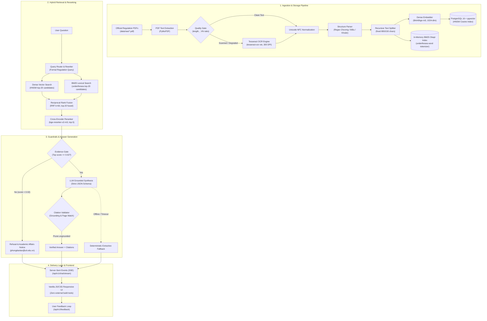
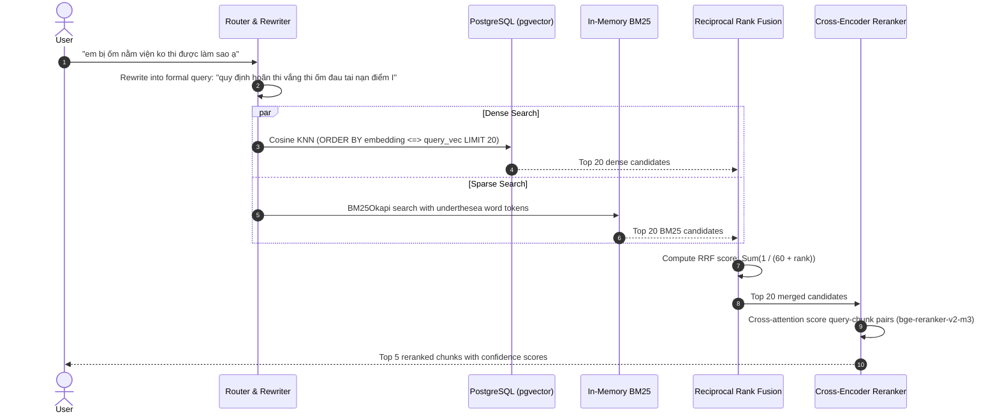
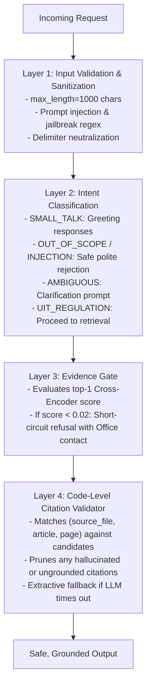

# UITBOT System Architecture

UITBOT is a production-grade, grounded Vietnamese Retrieval-Augmented Generation (RAG) assistant designed for student academic regulations at the University of Information Technology (VNU-HCM - UIT).

---

## 1. High-Level Architecture Overview

The system is organized into a modular 4-tier architecture decoupling data ingestion, hybrid retrieval, guardrailed generation, and client delivery:

---

## 2. Ingestion & Quality Gate Pipeline

1. **Extraction**: Reads raw PDF regulations from `data/raw/` using `PyMuPDF` (`fitz`).
2. **Quality Heuristics**: Automatically inspects every page:
   - Character count $\ge 50$.
   - Replacement character (`\ufffd`) ratio $\le 0.02$.
   - Vietnamese accented vowel ratio $\ge 0.15$.
   Pages failing any heuristic are transparently routed to `Tesseract OCR` (`vie`, 300 DPI).
3. **Normalization**: Strips duplicate blank lines, unifies hyphens, and converts all strings to standard Unicode NFC (`unicodedata.normalize("NFC", text)`).
4. **Structural Extraction**: Identifies organizational units (`Chương`, `Mục`, `Điều`) and preserves them alongside metadata (`source_file`, `page_start`, `page_end`, `chapter`, `article`, `article_title`).
5. **Multi-Model Storage**:
   - `chunks`: Master table storing chunks, source files, page spans, and text.
   - `chunk_embeddings_<model_slug>`: Dynamic vector tables dedicated to each embedding model slug, indexed with `HNSW (m=16, ef_construction=64, vector_cosine_ops)`.

---

## 3. Retrieval & Reranker Architecture

Empirical evaluation demonstrated that relying exclusively on Dense or BM25 search leaves severe blind spots in university regulation search:

---

## 4. Guardrails & Anti-Hallucination Architecture

UITBOT enforces 4 defense-in-depth safety layers before returning an answer:

---

## 5. Security & Isolation

- **Non-Root Execution**: Runs under unprivileged user `uitbot` (UID 1000, GID 1000) inside Docker.
- **Credential Hygiene**: Zero secrets in source code or git history; all configuration loaded via environment variables and `.env`.
- **Input Sanitization**: Control characters, delimiter spoofing (`--- [TÀI LIỆU ... ---`), and XML tag injections are stripped before prompt assembly.
- **Safe Prompt Delimiting**: User queries are isolated within `<user_query>` tags accompanied by strict system instructions forbidding prompt overriding.
- **XSS Immunity**: The web interface builds DOM nodes exclusively via `textContent` and `createElement`, completely avoiding `innerHTML` execution.
