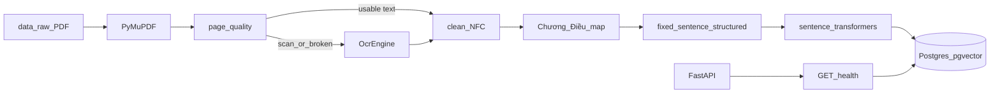

# UITBOT architecture (Phase 1)

UITBOT will be a RAG assistant over official UIT regulations. Phase 1 only builds configuration, PostgreSQL storage, and the ingest pipeline. Retrieval, generation, and evaluation land in later phases.

## Runtime

- `app/main.py` serves `GET /health` and the static UI.
- `app/config.py` reads `.env` via pydantic-settings.
- `app/db/pool.py` holds a psycopg 3 pool used by the API.
- Ingest uses a dedicated connection in `scripts/ingest.py`.

## Data

- `chunks` stores text plus article/page metadata and a `chunk_set` name.
- `chunk_embeddings_<model_slug>` stores vectors for one embedding model.
- `feedback` is created empty for later phases.

## Ingest command

`python scripts/ingest.py` runs extract → optional OCR → structure → chunk → embed → idempotent upsert, then writes `data/processed/ocr_review.csv` for manual OCR checks.
